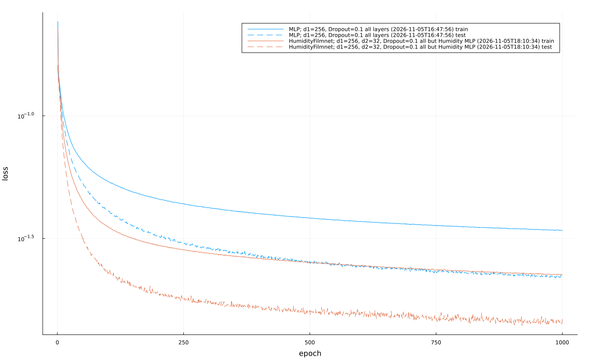

# Toxic gas identification by Bertin Technologies

Solution to the Toxic gas identification challenge by Bertin Technologies, hosted on [Challenge Data](https://challengedata.ens.fr) (ENS Paris, Collège de France, Institut Louis Bachelier).

# The challenge
All information can be found at [this link](https://challengedata.ens.fr/challenges/156) 

The challenge goal is to predict an alarm level between 0 and 1 for 23 classes (the gas itself and its characteristics, e.g. nerve agent or not). The metric is a weighted RMSE: errors on samples where an alarm should be raised (true value $\geq 0.5$) count $1.2$ times more.

For the data, each sample contains:
- 8 sensors from two groups of neighbouring sensors: M4–M7 and M12–M15,
- 4 complementary sensors: S1–S3 and R,
- Humidity, the absolute humidity (because it affects the measurements).

The targets are c01–c23, each between 0 and 1.

**Source:** data provided by Bertin Technologies through Challenge Data. Datasets on Challenge Data are distributed under the Licence Ouverte Etalab unless the challenge page states otherwise.
>The data is not included in this repository. Register on the challenge page, download the files and place them in data/

# Approach and results

## Approach
The main difficulty of this challenge is humidity. Humidity affects sensors, in different ways depending on how the sensor works (can be an offset or a non-linear transformation). Also, several gases in training data only appear at certain humidities, which means we need a way to generalise humidity, e.g c16 only appears between 0.8 and 0.93 humidity, so the model learns 0.8 humidity is c16, but c16 might also appear at lower humidities. On the data preprocessing:
- Groups of neighbouring sensors (M4–M7) and (M12–M15) is transformed with $\operatorname{asinh}(M\cdot\theta)/\theta$ where $\theta$ is 1 over the standard deviation of the group.
- S1–S3 and R are log transformed as their value are positive.

My first approach for my first result, will consist of a MLP depending only on humidity to produce and modify the hidden features of the first layer, it is the FiLM (Feature-wise Linear Modulation), basically a small separate MLP outputs $\gamma$ and $\beta$ and we apply the following transformation to the features of the first layer: $x\cdot(1+\gamma) + \beta$.

## Results
As of 2026-11-05 I rank of 230/256 with a score of $0.1646$, the benchmark being 187/256 with a score of $0.1567$.

| Ranking     | Method        | Score      |
|:-----------:|:-------------:|:----------:|
| **187**     | **Benchmark** | **0.1567** |
| 230         | FiLM          | 0.1646     |


| Losses                                             |
|:--------------------------------------------------:|
|  |

# Reference

```BibTex
@misc{bertin2026toxicgas,
    title        = {Toxic gas identification},
    author       = {{Bertin Technologies}},
    howpublished = {Challenge Data, ENS Paris, Collège de France and Institut Louis Bachelier},
    year         = {2026},
    url          = {https://challengedata.ens.fr/challenges/156},
    note         = {Accessed: 2026-11-04}
}
```